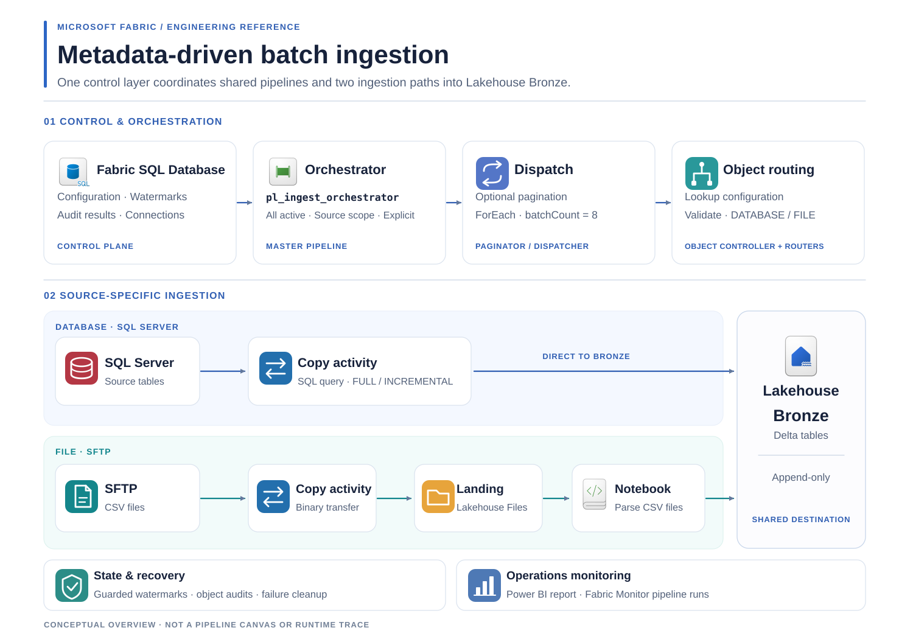

<h1 align="center">Metadata-Driven Pipelines in Microsoft Fabric</h1>

<p align="center">
  <strong>Configure ingestion for many source objects without building a separate pipeline for each one.</strong>
</p>

<p align="center">
  
  
  
</p>

<p align="center">
  <a href="#architecture">Architecture</a> ·
  <a href="#design-highlights">Design highlights</a> ·
  <a href="#how-the-framework-works">How it works</a> ·
  <a href="#explore-the-implementation">Documentation</a> ·
  <a href="#run-the-example">Run the example</a>
</p>

Separate pipelines work well for a few source objects, but repeating the same load logic across many objects becomes harder to maintain.

This repository implements a **metadata-driven ingestion framework in Microsoft Fabric**. Configuration tables define which source objects to process, how to load them, and where to write the results. Instead of building a pipeline for every object, the framework uses the same orchestration logic to process multiple source objects, with consistent watermark handling and run auditing.

The current implementation covers **batch ingestion** from SQL Server tables and SFTP CSV files into **Bronze Delta tables in a Fabric Lakehouse**. Both source paths support FULL and INCREMENTAL loads.

## Architecture



Fabric SQL Database stores source configurations, incremental checkpoints (**watermarks**), and run audits. Fabric Data Pipelines use this configuration to route each source object through the appropriate ingestion path into Bronze Delta tables in the Lakehouse.

See [Architecture & Design Decisions](docs/architecture/framework-overview.md) for the pipeline structure and design trade-offs.

## Design highlights

- **Configuration-driven ingestion.** Metadata defines each object's load strategy, source adapter, and Bronze target.
- **Full and incremental loads.** Choose FULL or INCREMENTAL loading through metadata, with processing tailored to each source type.
- **Watermark management.** Watermarks advance only after successful REGULAR incremental loads. BACKFILL and no-new-data SKIPPED runs leave them unchanged.
- **Audit and monitoring.** Track pipeline execution in Fabric Monitor and review recorded ingestion results through SQL audit tables and Power BI.

## How the framework works

| Step | What happens |
| --- | --- |
| **1. Configure sources** | `control.ingestion_config` defines each source object, its DATABASE or FILE ingestion pattern, FULL or INCREMENTAL load strategy, and Bronze target. `control.connection_settings` maps logical connection references. |
| **2. Select and dispatch** | `pl_ingest_orchestrator` selects all active configurations, one source system, or explicit object requests. A paginator and dispatcher pass the selected object requests to the Object Controller. |
| **3. Route each object** | `pl_ingest_object_controller` reads the configuration. The DATABASE or FILE router then calls the matching SQL Server or SFTP adapter. The same orchestration structure serves different objects. |
| **4. Load into Bronze** | For SQL Server, a Fabric Copy activity reads a SQL query for a full table load or a timestamp-based incremental window. For SFTP, Binary Copy moves CSV files to Landing before a Notebook parses them and appends Delta rows. |
| **5. Record results and update watermarks** | The framework records object-run outcomes in `audit.ingestion_log`. Successful REGULAR incremental loads can advance the watermark; BACKFILL and no-new-data SKIPPED runs do not. |
| **6. Inspect runs** | **Fabric Monitor** shows pipeline execution. The **Power BI Operations Report** summarizes recorded ingestion results from SQL audit data. |

## Explore the implementation

You can read the design and code without setting up a Fabric workspace. For a guided route through the project, start with the [step-by-step learning guide](docs/guides/learning-path.md). Or choose a topic:

| What you want to understand | Where to start |
| --- | --- |
| Why the architecture is structured this way | [Architecture & Design Decisions](docs/architecture/framework-overview.md) |
| How source configuration and orchestration work | [Control Plane](docs/guides/control-plane.md) · [Pipeline Orchestration](docs/guides/pipeline-orchestration.md) |
| How a SQL Server table reaches Bronze | [SQL Server Ingestion](docs/guides/sql-server-database-ingestion.md) |
| How SFTP files move through Landing and Bronze | [SFTP Ingestion](docs/guides/sftp-file-ingestion.md) |
| How SQL Server Copy partitioning and parallelism are designed | [Copy Performance Strategy](docs/architecture/database-copy-performance.md) |
| How Fabric limits and environment bindings affect deployment | [Fabric Limits](docs/architecture/fabric-data-factory-limits.md) · [Environment Bindings](docs/operations/variable-library-environment-binding.md) |
| How incremental checkpoints and recovery work | [Incremental Watermarks](docs/architecture/generic-incremental-watermark.md) · [Failure Cleanup](docs/operations/bronze-compensating-cleanup.md) |
| What the monitoring report can show | [Operations Monitoring](docs/operations/monitoring-report.md) |
| What was observed in DEV performance experiments | [Benchmark Evidence](docs/benchmarks/evidence-and-test-plan.md) |

The `fabric/` directory contains the tracked Fabric pipeline, Notebook, SQL Database, Lakehouse, and Power BI item definitions. The `scripts/` directory contains SQL setup scripts and sample data.

## Run the example

To reproduce the sample, follow the [fresh DEV workspace setup guide](docs/operations/environment-rebuild.md) and [SQL setup and sample data order](scripts/RUN_ORDER.md). The runbook targets a new, empty DEV workspace. Deployments to other environments require their own connections, permissions, item bindings, and validation; importing Git definitions alone is not sufficient.

Once the sources and Fabric items are configured, start `pl_ingest_orchestrator`. For example, to select the active SFTP example objects:

```text
p_run_requests = []
p_source_system = "LOGISTICS_VENDOR"
```

The orchestrator selects the objects and invokes the child pipelines for you. After a run, check its activities in **Fabric Monitor**, then inspect `audit.ingestion_log` and the **Power BI Operations Report** for recorded results. The [SFTP walkthrough](docs/guides/sftp-file-ingestion.md) shows how to compare Landing, Bronze, and watermark state.

If you need demo source services, [the optional EC2/Docker Compose setup](infra/source/README.md) describes the SQL Server and SFTP environment used for development. Review its environment-specific settings and safety notes before reusing it; it is not a one-command setup requirement for reading this project.

**Scope:** Additional source connectors and advanced scheduling or concurrency policies require further design; see [Architecture & Design Decisions](docs/architecture/framework-overview.md).

**License:** No license is currently included. Public access does not by itself grant reuse or redistribution rights.
