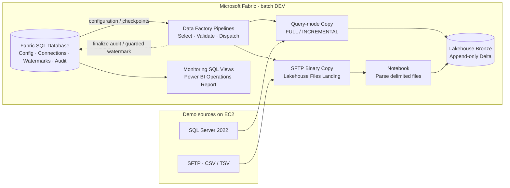

# Fabric Metadata-Driven Batch Ingestion

**A source-visible, production-oriented technical reference for learning metadata-driven batch ingestion with Microsoft Fabric.**

Microsoft Fabric Data Factory · Fabric SQL Database · Lakehouse/Delta ·
SQL Server · SFTP · PySpark · Power BI

Instead of hand-building and maintaining a separate end-to-end pipeline for
every source object, this implementation uses **one shared
Control Plane** to determine *what to ingest*, *how to ingest it*, and
*where to land it*. Fabric Pipelines implement routing and connector-native
copy; Notebooks handle reusable file parsing and failed-batch Delta cleanup.

**Current implementation:** SQL Server 2022 Developer on EC2 and SFTP demo
sources, writing append-only Bronze Delta tables. This is a **batch-only DEV
framework**, not a production-certified ingestion platform.

**Start here:** Read the [learning path](docs/guides/learning-path.md) for the recommended order. The [architecture overview](docs/architecture/framework-overview.md) explains the design, followed by [Control Plane](docs/guides/control-plane.md) and [Pipeline Orchestration](docs/guides/pipeline-orchestration.md). From there, explore [SQL Server Database Ingestion](docs/guides/sql-server-database-ingestion.md) or [SFTP File Ingestion](docs/guides/sftp-file-ingestion.md).

## Architecture at a glance



This conceptual view summarizes the implemented **batch-only DEV architecture**, not an observed run. The Data Factory orchestration group includes the child adapters that invoke finalization; the SQL Control Plane holds terminal object audits as well as configuration and checkpoints. See [Pipeline Orchestration](docs/guides/pipeline-orchestration.md) for the dispatch flow and the source-specific guides for the detailed activity paths.

The full [pipeline topology and design rationale](docs/architecture/framework-overview.md)
covers internal adapters, failure compensation, and the separation between
control state and source data.

## Implemented capabilities

| Area | What is implemented |
| --- | --- |
| **Metadata-driven execution** | One `control.ingestion_config` table; config selection by all-active, source-system scope, or explicit config requests |
| **Database ingestion** | SQL Server FULL / timestamp-watermark INCREMENTAL; query-mode Copy; `NONE` or `DYNAMIC_RANGE` partitioning; optional parallel-copy override |
| **File ingestion** | SFTP FULL / incremental by remote `last_modified_time`; Binary Copy into Landing; Notebook parses **DELIMITED_TEXT only** (CSV/TSV) |
| **Execution intent** | `REGULAR` and `BACKFILL`, independent from persisted `FULL` / `INCREMENTAL` load strategy |
| **State safety** | Persistent watermarks, guarded success finalization, optimistic state-update conflict detection; no checkpoint advancement for backfill or no-data skips |
| **Bronze discipline** | Immutable successful batch appends with batch/run lineage; compensating cleanup scoped to the current failed execution |
| **Operations** | Terminal object audit with SUCCESS / FAILED / SKIPPED plus supported WARN / CANCELLED statuses; source-level SQL views and a Desktop-authored Power BI report |
| **Rebuildability** | Fabric item definitions, SQL scripts, EC2 Docker Compose source setup, fixtures, and a [fresh-DEV rebuild runbook](docs/operations/environment-rebuild.md) |

The operational entry point is **`pl_ingest_orchestrator`**. Internal child
pipelines are implementation details, not independent run targets.

## Design decisions and trade-offs

- **Control Plane separate from Data Plane.** SQL Database keeps execution
  metadata, watermark state, and audit; Lakehouse Bronze stores ingestion rows.
- **Connector-native Copy where possible.** SQL Server ingestion stays in
  Fabric Copy; Spark is used when Landing files need parsing or Delta cleanup.
- **AUTO vs TUNED are distinct Copy branches.** A DEV PoC showed that explicitly
  setting `parallelCopies = 0` is *not* equivalent to omitting the property
  for service-managed AUTO behavior.
- **Backfill is not a watermark reset.** Historical incremental ranges are
  explicit and cannot overwrite the current operational checkpoint.
- **No distributed transaction claim.** Failed Bronze writes require
  execution-scoped compensation; only success finalization can advance
  operational state.
- **Keep the scope honest.** No implemented CDC, API connector, streaming,
  Silver/Gold transformations, data-contract subsystem, or production SLA.

See [Architecture & Design Decisions](docs/architecture/framework-overview.md)
for detailed rationale and implementation boundaries.

## Observed DEV evidence (not a production benchmark)

| Observation | Recorded outcome | Interpretation |
| --- | --- | --- |
| Demo all-active run | 8 terminal object audits: 2 SUCCESS, 6 SKIPPED | Runtime example; not a full failure-path certification |
| Dispatcher `batchCount` comparison | 9m29s at 3 vs 4m44s at 8 for the documented light DEV run | Scoped DEV experiment, **not** general capacity scaling |
| Isolated 10M-row SQL Copy PoC | `parallelCopies: 0` copied 10M rows, `copyDuration=483s`, `usedParallelCopies=1` | Tests explicit zero; **not** AUTO equivalence |
| Power BI monitoring | Observed 2 Source Systems, 8 latest-batch Objects, 0 Failed Sources | Snapshot-based monitoring evidence, not real-time master job status |

Detailed [Evidence Register & Benchmark Plan](docs/benchmarks/evidence-and-test-plan.md)
separates observed results from experiments still requiring complete runs.
Screenshots/recordings are not bundled into the repository as verified evidence.

## Getting started / rebuilding later

**For a fresh DEV:** follow
[Environment Rebuild — Fresh DEV From Git](docs/operations/environment-rebuild.md)
first. It covers infrastructure, Fabric Git sync, SQL bootstrap, Connections,
Variable Library values, metadata seeds, Power BI DirectQuery rebinding,
and acceptance checks.

For detailed step order and sample data, see
[scripts/RUN_ORDER.md](scripts/RUN_ORDER.md). The demo is reproducible from
Definitions + generated fixtures, but **Git is not a backup** of historical
watermarks, audit records, Lakehouse rows or credentials.

```text
fabric/                  Fabric item definitions: 12 Pipelines, 3 Notebooks,
                         Control SQL Database, Lakehouse, Library, Report/Model
scripts/control/         SQL bootstrap, connection/config seeds, verification
scripts/source/          SQL Server demo + benchmark fixtures; SFTP CSV samples
infrastructure/source/   Docker Compose for SQL Server + SFTP
docs/architecture/       Technical rationale and connector contracts
docs/operations/         Runbooks, monitoring and failure semantics
docs/guides/             A guided technical reading path
docs/benchmarks/        Experimental evidence and reproducible test plan
```

**Other useful references:** [Learning path](docs/guides/learning-path.md) · [Control Plane](docs/guides/control-plane.md) · [Pipeline Orchestration](docs/guides/pipeline-orchestration.md) · [SQL Server database ingestion](docs/guides/sql-server-database-ingestion.md) · [SFTP file ingestion](docs/guides/sftp-file-ingestion.md) · [Run parameters](docs/operations/run-request-examples.md) ·
[Watermark semantics](docs/architecture/generic-incremental-watermark.md) ·
[Copy tuning](docs/architecture/database-copy-performance.md) ·
[Bronze compensation](docs/operations/bronze-compensating-cleanup.md) ·
[Monitoring report](docs/operations/monitoring-report.md)

### Portability and scope caveat

The checked-in Fabric Variable Library and Power BI DirectQuery model
contain **DEV environment IDs / endpoint names**. These are not portable
credentials. Rebinding and permission grants are mandatory in a new workspace.
The SQL Project also contains a workspace-specific Entra principal that must
be reviewed rather than applied blindly.

The architecture is designed to *illustrate engineering choices* with
runnable DEV artifacts, not to imply deployment to multiple vendors or
full end-to-end disaster recovery.

## Publication and reuse status

This public repository is **source-visible, but currently has no open-source
license**. Public visibility alone does not grant reuse, redistribution, or
relicensing rights. Ownership and confidentiality must be reviewed before any
open-source license is added or reuse permissions are asserted. This
repository does not claim client endorsement or production certification.
