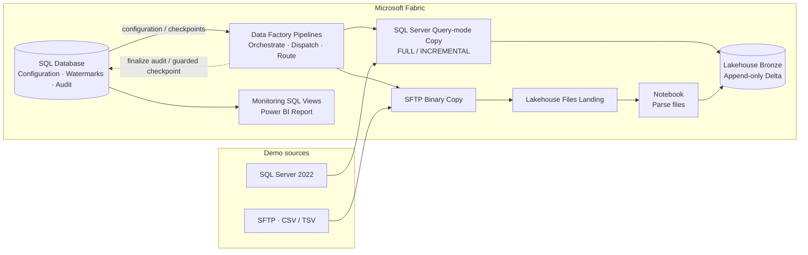

# Fabric Metadata-Driven Batch Ingestion

This repository demonstrates **metadata-driven batch ingestion in Microsoft Fabric**. Instead of creating a separate pipeline for every source object, it uses shared orchestration, configuration, and state management to ingest SQL Server tables and SFTP files into append-only Lakehouse Bronze Delta tables.

**Technology:** Fabric Data Factory · Fabric SQL Database · Lakehouse / Delta · SQL Server 2022 · SFTP · PySpark · Power BI

## Architecture



The **Control Plane** stores configuration, connection references, checkpoints, and terminal object audits in Fabric SQL Database. Data Factory Pipelines resolve and dispatch object requests. SQL Server Copy loads directly to Bronze; SFTP Copy preserves files in Landing before a Notebook parses them into Bronze.

See [Architecture & Design Decisions](docs/architecture/framework-overview.md) for the pipeline boundaries and trade-offs.

## Key behaviors

| Area | Behavior |
| --- | --- |
| **Metadata-driven routing** | `control.ingestion_config` defines source objects, load strategies, and targets; `control.connection_settings` resolves logical connections. |
| **Run selection** | `pl_ingest_orchestrator` runs all active objects, a source-system subset, or explicit object requests. |
| **Database ingestion** | SQL Server FULL and timestamp-watermark INCREMENTAL use Query-mode Copy to append Bronze Delta. |
| **File ingestion** | SFTP FULL and Last Modified INCREMENTAL use Binary Copy to Landing and Notebook parsing for CSV/TSV (`DELIMITED_TEXT`). |
| **Run semantics** | `REGULAR` and `BACKFILL` are execution intents. Successful historical BACKFILL does not advance the operational watermark; no-new-data runs can finish `SKIPPED`. |
| **Reliability** | Guarded watermark updates, terminal object audits, and execution-scoped compensation handle selected failure cases without claiming a distributed transaction. |
| **Monitoring** | SQL views over `audit.ingestion_log` feed the Power BI Operations Report. |

## Explore the implementation

| Topic | Guide |
| --- | --- |
| End-to-end walkthrough | [Technical Learning Path](docs/guides/learning-path.md) |
| Configuration, run requests, and dispatch | [Control Plane](docs/guides/control-plane.md) · [Pipeline Orchestration](docs/guides/pipeline-orchestration.md) |
| SQL Server FULL / INCREMENTAL | [Database Ingestion](docs/guides/sql-server-database-ingestion.md) |
| SFTP FULL / INCREMENTAL | [File Ingestion](docs/guides/sftp-file-ingestion.md) |
| Checkpoint behavior and failure recovery | [Incremental Watermarks](docs/architecture/generic-incremental-watermark.md) · [Bronze Compensating Cleanup](docs/operations/bronze-compensating-cleanup.md) |
| Monitoring and recorded experiments | [Operations Monitoring](docs/operations/monitoring-report.md) · [Benchmark Evidence](docs/benchmarks/evidence-and-test-plan.md) |

The implementation is tracked under `fabric/` (Pipelines, Notebooks, SQL Database, Lakehouse, and Power BI definitions). SQL setup and example fixtures are under `scripts/`; the optional SQL Server/SFTP demo-source environment is under `infrastructure/source/`.

## Run the DEV example

1. Follow the [Environment Rebuild Guide](docs/operations/environment-rebuild.md) to provision or connect the required Fabric items, sources, connections, and Variable Library values.
2. Use [scripts/RUN_ORDER.md](scripts/RUN_ORDER.md) for SQL bootstrap, sample metadata, and source data setup.
3. Start **`pl_ingest_orchestrator`** in Fabric. To select the active SFTP demo objects, set:

   ```text
   p_run_requests = []
   p_source_system = "LOGISTICS_VENDOR"
   ```

4. Inspect the resulting object executions in Fabric Monitor and the terminal rows in `audit.ingestion_log`. Use the [SFTP walkthrough](docs/guides/sftp-file-ingestion.md) to correlate Landing, Bronze, audit, and watermark behavior.

Child pipelines are implementation components; use `pl_ingest_orchestrator` as the supported entry point.

## Scope and limitations

This is a **batch-only DEV reference implementation** for SQL Server and SFTP. It does not implement CDC, streaming, API ingestion, Silver/Gold transformations, or production operations/SLA guarantees. The SQL control/audit database and Bronze Lakehouse do not share an end-to-end distributed transaction.

Fabric item definitions may contain environment-specific workspace IDs and connection references; a fresh deployment requires rebinding. For observed DEV runs and the limits of the performance experiments, see the [Evidence Register](docs/benchmarks/evidence-and-test-plan.md).

**License:** No license is included. Public access to the source does not by itself grant reuse or redistribution rights.
