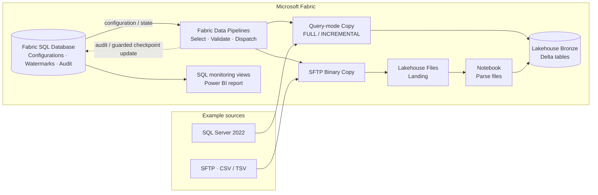

# Fabric Metadata-Driven Batch Ingestion

Building a separate pipeline for each source table can be a sensible choice when the requirements are simple and stable. But as more tables and source systems are added, maintaining the same ingestion logic across many pipelines takes more effort.

This project explores a **metadata-driven approach to batch ingestion using Microsoft Fabric Data Pipelines**. Rather than creating a new pipeline for every source object, a shared framework reads configuration tables to decide what to ingest, how to load it, and where to store it. The goal is to reduce repetitive pipeline development while keeping control over incremental state, audit logging, and failure handling.

The implementation uses **SQL Server and SFTP** as example sources and writes to **append-only Bronze Delta tables** in a Fabric Lakehouse.

## Architecture



The framework separates **control and state** from **data movement**. Fabric SQL Database stores ingestion configurations, connection references, watermarks, and terminal object audits. Fabric pipelines handle request selection and routing. SQL Server data is copied directly to Bronze; SFTP files are preserved in Landing before a Notebook reads and appends them to Bronze.

For the decisions behind this design, see [Architecture & Design Decisions](docs/architecture/framework-overview.md).

## How it works

| Part | What it does |
| --- | --- |
| **Shared orchestration** | `pl_ingest_orchestrator` runs all active configurations, one source-system subset, or an explicit list of requests. |
| **Metadata-driven routing** | `control.ingestion_config` and `control.connection_settings` identify source objects, supported loading patterns, and targets. |
| **SQL Server ingestion** | FULL or timestamp-based INCREMENTAL loads use query-mode Copy into Bronze. |
| **SFTP ingestion** | FULL or Last Modified INCREMENTAL loads use Binary Copy to Landing, followed by CSV/TSV parsing in a Notebook. |
| **Incremental state** | A successful eligible `REGULAR` run can advance the watermark. `BACKFILL` and no-new-data `SKIPPED` runs do not advance it. |
| **Failure handling and monitoring** | SQL finalization guards checkpoint updates; execution-scoped cleanup handles supported failure paths, and audit records feed the Power BI Operations Report. |

**Why not one pipeline per table?** Separate pipelines may be simpler for a small, fixed set of sources or for objects that require very different logic. A metadata-driven framework adds setup and maintenance responsibilities, but becomes useful when many objects follow the same ingestion pattern and onboarding is frequent.

## Follow the implementation

You can explore the design without deploying anything. Start with the [Technical Learning Path](docs/guides/learning-path.md), or go directly to the topic you want to understand:

| Topic | Documentation |
| --- | --- |
| Configuration and orchestration | [Control Plane](docs/guides/control-plane.md) · [Pipeline Orchestration](docs/guides/pipeline-orchestration.md) |
| SQL Server ingestion | [Database Ingestion Guide](docs/guides/sql-server-database-ingestion.md) |
| SFTP ingestion | [File Ingestion Guide](docs/guides/sftp-file-ingestion.md) |
| Incremental windows and backfill | [Generic Incremental Watermark](docs/architecture/generic-incremental-watermark.md) |
| Finalization and cleanup | [Bronze Compensating Cleanup](docs/operations/bronze-compensating-cleanup.md) |
| Audit and monitoring | [Monitoring Report](docs/operations/monitoring-report.md) |

The `fabric/` directory contains Fabric item definitions. `scripts/` contains SQL setup and demo fixtures; `infrastructure/source/` contains the optional demo-source setup.

## Try the DEV example

To run the framework in a new DEV environment, follow the [Environment Rebuild Guide](docs/operations/environment-rebuild.md) and [SQL/source setup order](scripts/RUN_ORDER.md). A fresh workspace needs its own Fabric connections, permissions, and environment-specific bindings.

After setup, run **`pl_ingest_orchestrator`**. For example, to select the active SFTP configurations:

```text
p_run_requests = []
p_source_system = "LOGISTICS_VENDOR"
```

Use Fabric Monitor and `audit.ingestion_log` to inspect the actual object outcomes. The [SFTP guide](docs/guides/sftp-file-ingestion.md) shows how to follow the run through Landing, Bronze, and the checkpoint. Child pipelines are internal components, not standalone entry points.

## Scope

This is a **batch-only DEV reference implementation** covering SQL Server and SFTP. File parsing currently supports **delimited text (CSV/TSV)**. It does not implement CDC, streaming, API ingestion, or Silver/Gold transformations. Fabric SQL Database and Delta Lakehouse writes are **not one distributed transaction**. It does not claim production operations or SLA guarantees.

The implementation and its limitations can be inspected in the linked definitions and guides. For recorded performance experiments, see [Benchmark Evidence](docs/benchmarks/evidence-and-test-plan.md).

**License:** No license is currently included; public availability does not grant permission to reuse or redistribute the code.
