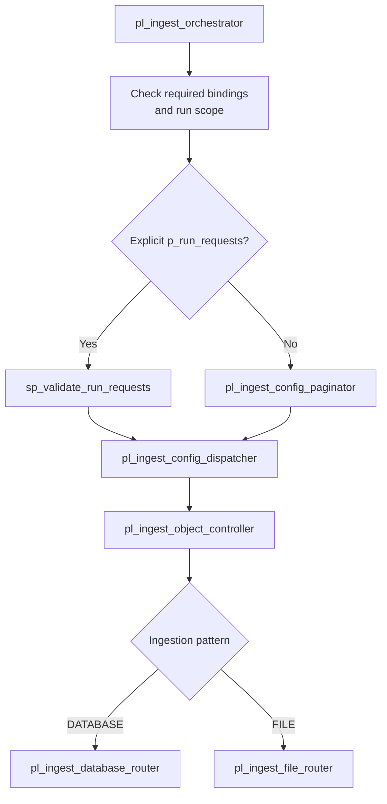

# Pipeline Orchestration and Run Requests

Control SQL defines the available source objects. Fabric Data Pipelines select requests, validate each configuration, and route it to the correct source adapter.

This guide traces the implemented orchestration flow from the entry parameters through the DATABASE and FILE
Routers. Read [Control Plane and Ingestion Configuration](control-plane.md) first if the metadata tables are
unfamiliar.

## 1. Start at the master pipeline

The supported entry point is `pl_ingest_orchestrator`. Its parameters are:

| Parameter | Type | Default | Purpose |
| --- | --- | --- | --- |
| `p_run_requests` | Array | `[]` | Explicit object requests, or empty to select active configurations |
| `p_source_system` | String | `""` | Optional source-system filter when the request array is empty |
| `p_config_page_size` | Integer | `1000` | Number of active configuration rows requested per page; accepted range 1 to 5000 |

A regular scheduled run can select all active configurations, one source system, or an explicit request list. You do not need a separate master pipeline for each object.

### Run all active configurations

```text
p_run_requests = []
p_source_system = ""
```

The Paginator reads every active configuration and assigns `REGULAR` execution intent. The configured `load_strategy` is still read separately for each object.

### Run a source-system subset

```text
p_run_requests = []
p_source_system = "ECOMMERCE"
```

Only active configurations from `ECOMMERCE` are selected. You can use `LOGISTICS_VENDOR` for the file examples instead.

### Run an explicit configuration

```json
[
  {
    "config_id": 1,
    "run_type": "REGULAR"
  }
]
```

Pass this array as `p_run_requests` and leave `p_source_system` empty. The ID is an example from the standard fresh
DEV seed; query `control.ingestion_config` for the actual ID before running.

For an INCREMENTAL historical BACKFILL, an explicit request also needs `lower_bound` and `upper_bound` . See
[Run Request Examples](../operations/run-request-examples.md) for the exact request shapes and boundaries.

A nonempty request array combined with a nonblank `p_source_system` fails with `AMBIGUOUS_RUN_SCOPE`. The framework does not silently pick one of those two scopes.

## 2. The master chooses one of two paths

Open [the Orchestrator definition](../../fabric/pl_ingest_orchestrator.DataPipeline/pipeline-content.json). Four top-level activities handle the entry decision:

1. `set_batch_id` generates a new Batch ID with `@guid()`.
2. `if_required_connections_provided` checks that required runtime Variable Library values are present.
3. `if_valid_run_scope` rejects a conflicting explicit request and source-system filter.
4. `if_explicit_run_requests` chooses the dispatch path.

The two paths rejoin logically at the Dispatcher:



*Conceptual routing based on the checked-in Fabric Pipeline definitions. Validation and pre-dispatch failure branches are summarized; this is not a screenshot of a particular run.*

The explicit request path invokes `control.usp_validate_run_requests` before dispatch. The Paginator path first
obtains active configurations from SQL. In either case, the Dispatcher receives an array of object requests and a
shared Batch ID.

## 3. Why is there a Paginator?

The Paginator keeps the number of configuration rows returned by each Lookup bounded. This matters as the number of
source objects grows, even though the current demo only has eight active objects.

The implemented `pl_ingest_config_paginator` pipeline:

1. Checks `p_config_page_size`, rejecting values outside 1 to 5000.
2. Uses `lkp_config_pagination_info` to count active configurations within the chosen source-system scope.
3. Fails with `NO_ACTIVE_CONFIGS` if the selected scope contains no active configuration.
4. Uses `fe_config_pages` to iterate through pages **sequentially**.
5. Uses `lkp_config_page` to select one page ordered by `ingestion_config_id`, then `inv_ingest_config_dispatcher` to process that page.

The page Lookup returns pairs of `config_id` and `run_type = REGULAR` . It does not copy every source field into the
request array. The Object Controller performs a separate configuration lookup for each object.

The current design uses sequential pages and bounded object parallelism inside each page. It does not promise that all active objects start at the same moment.

## 4. The Dispatcher runs object controllers

[`pl_ingest_config_dispatcher`](../../fabric/pl_ingest_config_dispatcher.DataPipeline/pipeline-content.json) contains `fe_run_requests`, a parallel ForEach with `batchCount = 8` in the current DEV baseline. For each item, `inv_ingest_object_controller` forwards:

- The shared `p_batch_id`.
- The requested `config_id` as `p_ingestion_config_id`.
- The execution intent `p_run_type`.
- Optional requested LOW/HIGH bounds (normalized to empty strings when omitted).

Do not confuse object parallelism with the master setting. The master Orchestrator currently has `concurrency = 1` ,
so two master executions are serialized. Within one master run, the Dispatcher can start up to eight object requests
in parallel.

This is an implemented DEV setting, not a general performance recommendation. The
[Benchmark Evidence](../benchmarks/evidence-and-test-plan.md) documents the limited comparison used to choose it.

## 5. The Object Controller looks up and validates configuration

[`pl_ingest_object_controller`](../../fabric/pl_ingest_object_controller.DataPipeline/pipeline-content.json) is where the request becomes a particular source and target. Its `lkp_ingestion_config` activity reads the chosen `ingestion_config_id` from `control.ingestion_config` and joins the source/target references from `control.connection_settings`.

The controller then checks:

- Does the requested configuration exist?
- Is it active?
- Are `run_type` and the supplied bounds valid for its `load_strategy`?
- Is the target connection type `LAKEHOUSE`?
- Which ingestion pattern does the configuration select?

The `sw_execution_decision` activity handles `INACTIVE`, `INVALID_REQUEST`, `INVALID_TARGET`, `DATABASE`, and `FILE` outcomes, with a default unsupported-route path.

An explicitly requested inactive configuration is finalized as `SKIPPED` . An invalid request or invalid target
follows a failure path. The controller only invokes a physical router after the metadata and execution request have
passed the relevant checks.

## 6. The Routers choose the physical adapter

The DATABASE and FILE Routers keep connector-specific behavior out of the Object Controller.

| Router | Route expression | Implemented destinations |
| --- | --- | --- |
| `pl_ingest_database_router` | Source connection type and load strategy | `SQL_SERVER\|FULL`, `SQL_SERVER\|INCREMENTAL` |
| `pl_ingest_file_router` | Source connection type and load strategy | `SFTP\|FULL`, `SFTP\|INCREMENTAL` |

The route key joins the uppercased connection type and load strategy with the pipe character (`|`), using `concat` in the Router activities.

The FILE Router first checks `if_supported_file_format` . At present, the accepted format is `DELIMITED_TEXT` . The
SQL Server INCREMENTAL adapter adds a separate Loader pipeline for Copy execution and finalization. Each physical
adapter is responsible for source-specific extraction, processing boundaries, and failure handling.

See [SQL Server Database Ingestion](sql-server-database-ingestion.md) ,
[Connector Responsibilities](../architecture/framework-overview.md#pipeline-roles-and-connector-boundary) , and
[SFTP File Ingestion](sftp-file-ingestion.md) for the next level of detail.

## 7. Trace a real run without guessing its result

If a DEV environment is available, start with a known source system rather than all eight objects:

```text
p_run_requests = []
p_source_system = "LOGISTICS_VENDOR"
```

Before running, inspect the two configurations in SQL. After execution, open the Fabric pipeline Monitor and follow
the child invocations through Dispatcher, Object Controller, FILE Router, and SFTP adapter.

Then check the object audits:

```sql
SELECT TOP (20)
    batch_id,
    pipeline_run_id,
    source_system,
    source_object,
    run_type,
    load_strategy,
    status,
    source_row_count,
    target_row_count,
    error_code,
    end_time
FROM audit.ingestion_log
WHERE source_system = 'LOGISTICS_VENDOR'
ORDER BY ingestion_log_id DESC;
```

The expected result depends on the remote files and current checkpoint. A FULL snapshot may append a new batch while
the unchanged INCREMENTAL movement feed finishes `SKIPPED` . You cannot infer the audit status from the parameter
values alone.

Use the shared Batch ID to connect the object outcomes, and the object Pipeline Run ID to inspect a specific
execution. A master run that fails before object dispatch may have **no object audit record**. Use Fabric Monitor
for that case.

For verification, compare the master run parameters and child activity outcomes in Fabric Monitor with the object
audit rows returned by the query. The diagram describes the implemented routing; only an observed run establishes
what happened in a particular execution.

## 8. What to read next

- [Control Plane](control-plane.md): the configuration and state each object reads.
- [SFTP File Ingestion](sftp-file-ingestion.md): Binary Copy to Landing, Notebook parsing, Bronze append and audit.
- [SQL Server Database Ingestion](sql-server-database-ingestion.md): a guided FULL and INCREMENTAL Copy example.
- [Connector Responsibilities](../architecture/framework-overview.md#pipeline-roles-and-connector-boundary): framework versus SQL Server adapter ownership.
- [Generic Incremental Watermark](../architecture/generic-incremental-watermark.md): processing boundaries, SKIPPED, and state changes.
- [Retry, Rerun, and Backfill](../operations/retry-rerun-backfill.md): execution intent versus data-loading strategy.

Only `pl_ingest_orchestrator` is a supported external execution entry point. The child pipelines in this guide are implementation components, not independent run targets.
