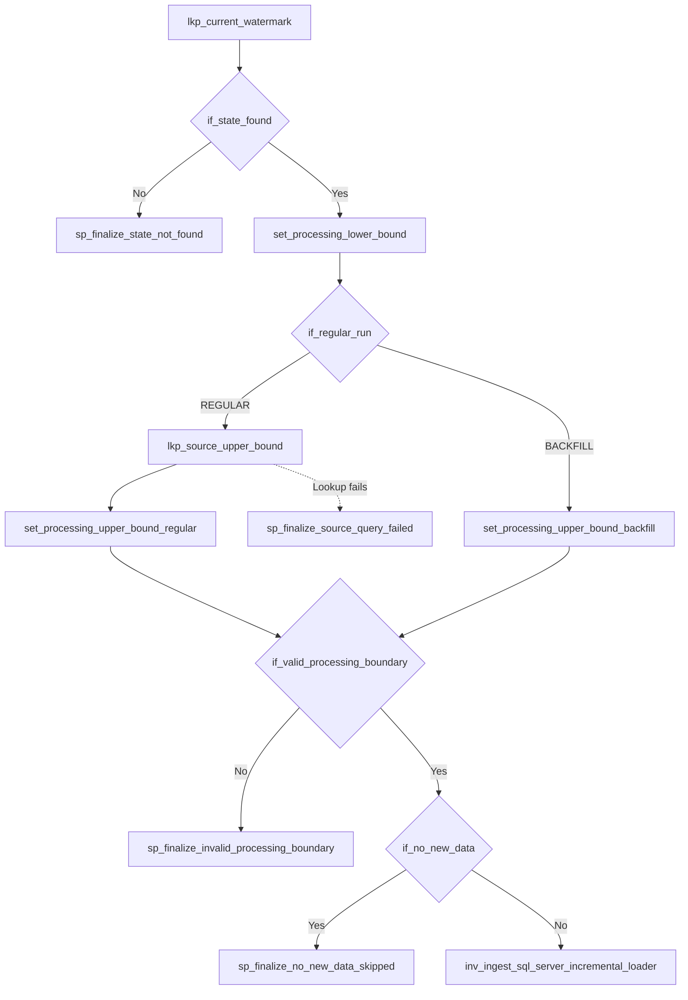
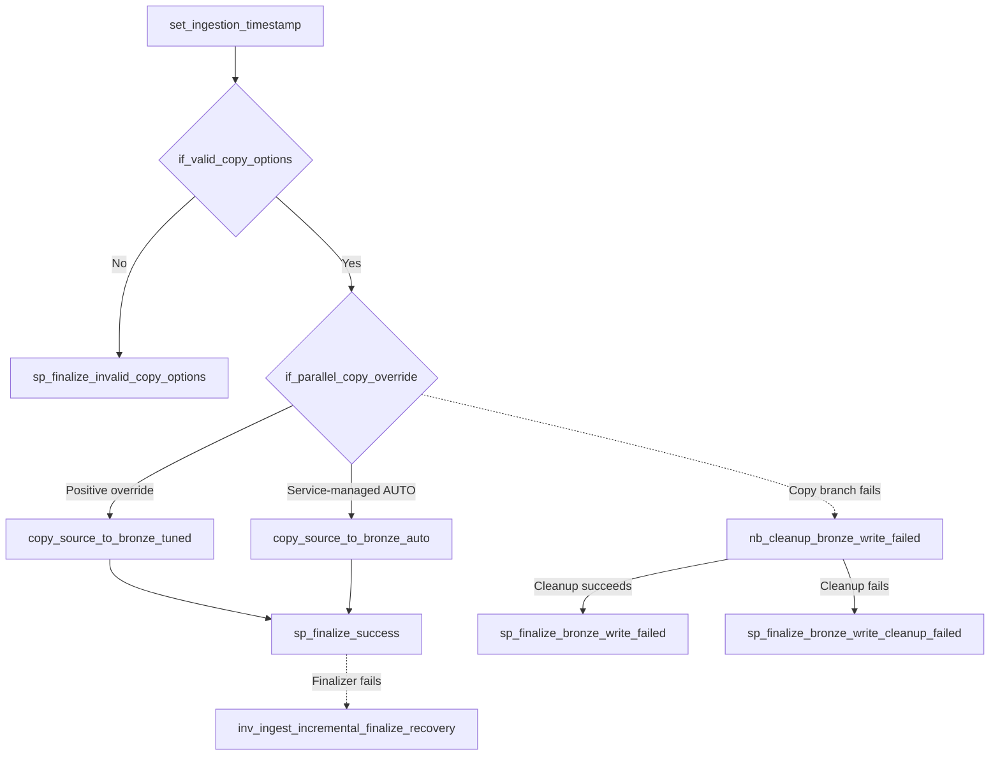

# SQL Server Database Ingestion

The current DATABASE implementation reads SQL Server 2022 Developer tables through Fabric Data Factory Copy activities and appends the results to Bronze Delta tables in a Fabric Lakehouse.

This guide compares FULL and INCREMENTAL execution, explains how the framework builds the source query, and shows where to check the resulting audit and watermark. The source SQL Server is separate from the Fabric SQL Database that stores pipeline configuration and state.

Start with [Control Plane](control-plane.md) and [Pipeline Orchestration](pipeline-orchestration.md) if you have not yet traced the configuration and request-dispatch flow.

## 1. Choose two database configurations

The DEV ingestion seed includes these representative objects:

| Source object | Load strategy | Watermark field | What it demonstrates |
| --- | --- | --- | --- |
| `catalog.product_categories` | FULL | None | Read the current full table and append a Bronze batch |
| `crm.customers` | INCREMENTAL | `updated_at` | Read a timestamp window determined by checkpoint state and the source |
| `sales.order_items` | INCREMENTAL | `updated_at` | The same incremental rules with optional connector-native Copy partitioning |

Inspect the current configuration with this read-only query in `sqldb_ingestion_control`:

```sql
SELECT
    ingestion_config_id,
    source_system,
    source_schema,
    source_object,
    load_strategy,
    watermark_field,
    copy_options,
    target_schema,
    target_table,
    is_active
FROM control.ingestion_config
WHERE source_system = 'ECOMMERCE'
  AND source_object IN ('product_categories', 'customers', 'order_items')
ORDER BY source_schema, source_object;
```

The seed is documented in [04_seed_ingestion_metadata.sql](../../scripts/control/04_seed_ingestion_metadata.sql). Use the returned `ingestion_config_id` for any explicit run request. Do not assume that an existing DEV SQL Database uses the original seed IDs.

## 2. How the DATABASE Router selects an adapter

All three objects go through the same main pipelines:

```text
pl_ingest_orchestrator
  -> pl_ingest_config_paginator or direct request dispatch
  -> pl_ingest_config_dispatcher
  -> pl_ingest_object_controller
  -> pl_ingest_database_router
       -> pl_ingest_sql_server_full_adapter
       -> pl_ingest_sql_server_incremental_adapter
            -> pl_ingest_sql_server_incremental_loader
```

The Object Controller resolves the configuration and its source/target connections. The DATABASE Router combines the connection type and the configured load strategy to select `SQL_SERVER|FULL` or `SQL_SERVER|INCREMENTAL`.

The incremental adapter owns the checkpoint lookup and processing bounds. When data should be loaded, it invokes the incremental Loader. That additional pipeline keeps the Copy execution and finalize/recovery path separate from the state-selection decisions.

Source definitions:

- [Database Router](../../fabric/pl_ingest_database_router.DataPipeline/pipeline-content.json)
- [FULL Adapter](../../fabric/pl_ingest_sql_server_full_adapter.DataPipeline/pipeline-content.json)
- [INCREMENTAL Adapter](../../fabric/pl_ingest_sql_server_incremental_adapter.DataPipeline/pipeline-content.json)
- [INCREMENTAL Loader](../../fabric/pl_ingest_sql_server_incremental_loader.DataPipeline/pipeline-content.json)

## 3. FULL: copy the current source table

For `catalog.product_categories`, the FULL Adapter builds a query against the configured SQL Server schema and table. It includes the source columns and these technical fields:

- `_batch_id`, the identifier of the master ingestion batch.
- `_pipeline_run_id`, the object execution identifier used for audit and recovery.
- `_ingestion_timestamp`, generated once for this adapter execution and cast as SQL Server `DATETIME2(3)` in the source query.

The Copy sink uses a Lakehouse table with `Append` behavior. In this DATABASE path there is **no separate Lakehouse Files Landing step**. The native Copy activity writes directly to the configured Bronze Delta table.

A later successful FULL run appends another batch. It does not truncate or replace a previously successful Bronze batch, so downstream consumers need to account for execution lineage when working with full snapshots.

## 4. INCREMENTAL: determine the processing window

The `crm.customers` configuration has `load_strategy = INCREMENTAL` and `watermark_field = updated_at`.

The INCREMENTAL Adapter starts by looking up the state for the exact `ingestion_config_id` and watermark field in `control.pipeline_watermarks`. The following **activity-level** diagram traces its control decisions, not every error-message or variable-assignment detail in the JSON.



**How to read this:** `lkp_current_watermark` and `if_state_found` validate the saved state first. REGULAR gets HIGH from a source Lookup; BACKFILL uses the explicitly requested HIGH. After boundary validation, only a REGULAR `HIGH = LOW` window takes the early `SKIPPED` branch. The other valid windows invoke the Loader.

The diagram stops at the initial finalize activities on the error branches to remain readable. Their dependent `fail_*` activities, along with the exact Fabric dependencies and error handling, remain in the [INCREMENTAL Adapter JSON](../../fabric/pl_ingest_sql_server_incremental_adapter.DataPipeline/pipeline-content.json). The diagram is derived from the checked-in definition, **not** an observed DEV run.

For a REGULAR run the upper bound comes from a source query:

```sql
SELECT MAX([updated_at]) AS upper_bound
FROM [crm].[customers];
```

That query illustrates the shape of the generated SQL for this object. The actual adapter builds its identifiers from the validated configuration rather than hardcoding `crm.customers`.

For an eligible nonempty window, the incremental Loader builds a SQL Server query with the following timestamp predicate:

```sql
WHERE [updated_at] > CONVERT(datetime2(7), @LOW, 126)
  AND [updated_at] <= CONVERT(datetime2(7), @HIGH, 126)
```

`@LOW` and `@HIGH` are explanatory placeholders here, **not literal T-SQL variables supplied by the existing Copy Activity**. The actual Fabric expression inserts the runtime boundary strings into the generated source SQL. Refer to the Loader JSON for the executable expression.

The window includes values after LOW and up to HIGH. The source-derived timestamp precision is preserved by the current SQL Server boundary contract.

### What if the source has no newer timestamp?

For a REGULAR DATABASE run, `HIGH = LOW` is a valid no-new-data window. The adapter records `SKIPPED` without invoking the incremental Loader and without advancing the checkpoint.

If HIGH is lower than LOW, the run fails boundary validation. BACKFILL requires HIGH greater than LOW.

A HIGH greater than LOW does not itself prove that the Copy wrote rows. The rule above describes the adapter's explicit no-new-data branch, not an automatic classification of every zero-row Copy.

### When does the watermark advance?

The SQL Finalizer advances the persistent watermark only for eligible successful REGULAR INCREMENTAL processing. The expected stored value must still match the value read at the start of the run. This protects against a competing execution moving the state unexpectedly.

A historical BACKFILL processes the explicitly requested range and **does not** advance the normal operational watermark. It appends a distinct Bronze batch, preserving the existing successful batches.

Read [Generic Incremental Watermark](../architecture/generic-incremental-watermark.md) and [Retry, Rerun, and Backfill](../operations/retry-rerun-backfill.md) for the full contract.

## 5. Copy settings come from metadata

The `copy_options` field configures connector-native Copy execution. It is separate from the `load_strategy` and `watermark_field`.

Most normal DEV database configurations have `copy_options = NULL`. In the current SQL Server adapter, that means unpartitioned Copy with service-managed parallelism. The `sales.order_items` example uses:

```json
{
  "partition_option": "DYNAMIC_RANGE",
  "partition_column": "order_item_id"
}
```

The FULL Adapter and INCREMENTAL Loader each have two Copy branches:

| Branch | When selected | `parallelCopies` property |
| --- | --- | --- |
| `copy_source_to_bronze_auto` | No positive override provided | Omitted, allowing the service to manage parallelism |
| `copy_source_to_bronze_tuned` | Positive `parallel_copies` override | Set explicitly from metadata |

The routing gate checks that the Copy options are valid before the Copy stage. The optional dynamic-range mode uses a partition predicate generated for the SQL Server connector; it does not change the ingestion checkpoint definition.

The separate **INCREMENTAL Loader** implements the Copy and finalization portion of the flow:



The solid arrows show the normal execution path; dashed arrows mark the **failed activity dependencies** in the Fabric definition. The Cleanup Notebook is triggered when the Copy branch fails; it is not part of a successful Copy path. The Finalizer recovery child is invoked only when `sp_finalize_success` fails, because a failed response does not prove whether the SQL transaction committed.

The complete definitions also include the count-setting activities following each Copy and terminal `Fail` activities after error finalization. They are omitted from the visual only to keep the control decisions legible; see the [INCREMENTAL Loader JSON](../../fabric/pl_ingest_sql_server_incremental_loader.DataPipeline/pipeline-content.json) and [Bronze Compensating Cleanup](../operations/bronze-compensating-cleanup.md) for those details.

An earlier isolated DEV experiment showed that explicitly setting `parallelCopies = 0` was not equivalent to omitting the property. This is why the AUTO branch omits it. Do not treat that observation as a general performance benchmark.

See [Database Copy Performance](../architecture/database-copy-performance.md) and [Benchmark Evidence](../benchmarks/evidence-and-test-plan.md) for the actual option contract and recorded test limitations.

## 6. Verify the results after a DEV run

To execute one object through the supported entry point, first obtain the actual configuration ID. Then pass an explicit request to `pl_ingest_orchestrator`:

```json
[
  {
    "config_id": 1,
    "run_type": "REGULAR"
  }
]
```

This is a request-format example. Replace `1` with the actual ID returned by SQL, and keep `p_source_system` empty. For all active E-commerce objects, use `p_run_requests = []` with `p_source_system = "ECOMMERCE"` instead.

After an actual run, inspect the latest object audits:

```sql
SELECT TOP (20)
    batch_id,
    pipeline_run_id,
    source_schema,
    source_object,
    load_strategy,
    run_type,
    status,
    processing_lower_bound,
    processing_upper_bound,
    source_row_count,
    target_row_count,
    error_code,
    end_time
FROM audit.ingestion_log
WHERE source_system = 'ECOMMERCE'
ORDER BY ingestion_log_id DESC;
```

For the incremental examples, compare the saved checkpoint before and after the run:

```sql
SELECT
    c.source_schema,
    c.source_object,
    w.watermark_field,
    w.last_watermark_value,
    w.last_successful_pipeline_run_id,
    w.watermark_updated_at
FROM control.ingestion_config AS c
JOIN control.pipeline_watermarks AS w
    ON w.ingestion_config_id = c.ingestion_config_id
WHERE c.source_system = 'ECOMMERCE'
ORDER BY c.source_schema, c.source_object;
```

Match the Fabric object Run ID, SQL audit row, and Bronze `_pipeline_run_id` when checking a specific execution. A green Copy activity alone does not establish the final audit or checkpoint outcome.

## 7. Failure and recovery boundaries

A successful Delta write and the SQL Control Database finalization are not one distributed transaction. The framework uses execution-scoped Bronze cleanup when a failed write may have left rows behind. If success finalization fails with an uncertain outcome, the incremental recovery flow checks durable state before deciding how to proceed.

The [Bronze Compensating Cleanup runbook](../operations/bronze-compensating-cleanup.md) now includes activity-level Mermaid diagrams for both **Bronze write failure** and **post-finalization reconciliation**. Follow those diagrams alongside the Pipeline JSON to see why cleanup is conditional on the failure boundary. These behaviors should not be simplified into a claim that every rerun is automatically exactly once at business-record level.

### Check the run before drawing conclusions

In Fabric Monitor, inspect the executed FULL or INCREMENTAL Copy branch and match its object Pipeline Run ID to `audit.ingestion_log`. For an incremental run, compare the stored watermark before and after finalization. The Copy activity's success alone does not confirm the terminal audit or checkpoint update. This guide documents implementation behavior; the observed result depends on the DEV source state at execution time.
