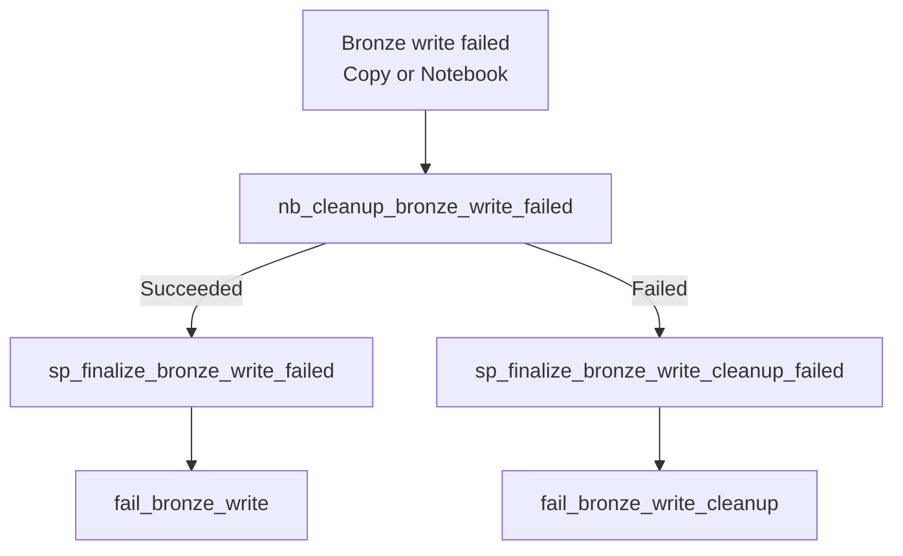
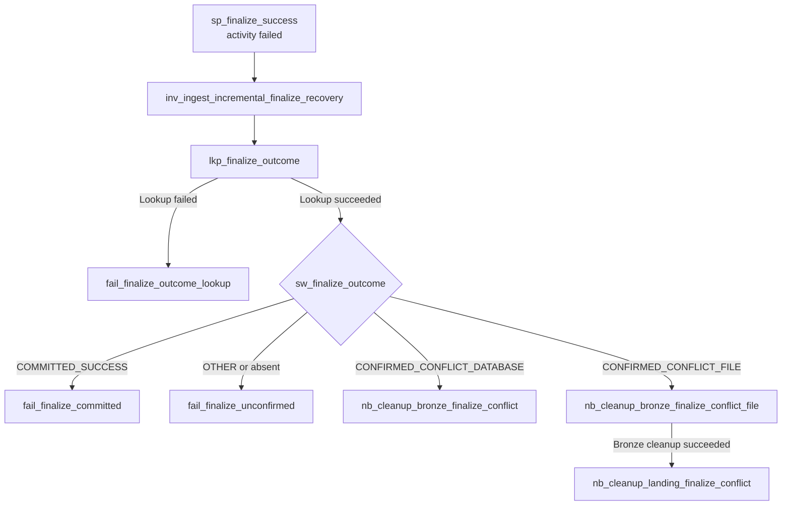

# Bronze Compensating Cleanup

This runbook explains when a failed ingestion may remove its own Bronze or Landing writes, and why a successful
batch must remain intact. It distinguishes confirmed failed writes from uncertain SQL finalization.

## Framework invariant

Bronze ingestion is append-only for every successful ingestion execution, regardless of run type.

```text
REGULAR  -> append a new Bronze batch
BACKFILL -> append a new Bronze batch
```

A successful Bronze batch is never deleted, truncated, overwritten, or replaced merely because a later REGULAR or
BACKFILL run processes overlapping source data. Each execution preserves its own `_batch_id` / pipeline-run lineage.

The only ingestion-time deletion allowed by this framework is **compensating cleanup of the current failed batch**
when a Bronze write may have partially succeeded. That failed batch is not treated as committed Bronze history.

Retention, legal erasure, or other lifecycle-management policies are separate governance/maintenance concerns and are not part of REGULAR/BACKFILL ingestion semantics.

## Why it exists

A Bronze write and the control/audit finalization are not one distributed transaction. A pipeline can fail after
rows have already reached Bronze while the watermark/control state remains uncommitted. A blind rerun can then
append the same logical input again.

The recovery scope is the pair **(`batch_id`, `pipeline_run_id`)** in the
specific target Delta table. The orchestrator intentionally shares a batch ID
across different configs for correlation; the object controller has its own
pipeline run ID. Both metadata columns are present in the SQL Server and SFTP
Bronze outputs. Filtering only by batch ID could remove another config's rows
if two configs write to the same target in one orchestrator batch.

## FILE Landing cleanup isolation

An orchestrator batch may include multiple `ingestion_config_id` values
that share a Landing base path (and may target the same Bronze table).
SFTP FULL and INCREMENTAL Landing paths therefore use the leaf scope
`ingestion_date=<date>/ingestion_config_id=<id>/batch_id=<id>/pipeline_run_id=<object_run_id>/`.
Landing cleanup validates these exact trailing segments before recursively
deleting the failed execution's leaf folder; it cannot delete a sibling
config/run folder. The audit `landing_path` points to the same execution
folder used by Copy and the Notebook. Bronze cleanup separately uses the
existing `(_batch_id, _pipeline_run_id)` predicate.

## Reusable component

The framework uses one notebook item:

```text
nb_cleanup_bronze_batch_rows
```

Inputs:

```text
p_workspace_id
p_lakehouse_id
p_target_schema
p_target_table
p_batch_id
p_pipeline_run_id
```

The notebook resolves the target Delta table, counts rows matching **both**
`_batch_id` and `_pipeline_run_id`, deletes only those rows, re-counts that
same object execution, and fails with `BRONZE_CLEANUP_INCOMPLETE` if any
matching rows remain.

The notebook is idempotent: a retry against an already-clean batch succeeds with zero rows removed.

If the target Delta path does not exist because the failed write never created the
Bronze table/path, cleanup is also a successful no-op. The notebook emits
`BRONZE_CLEANUP_NOOP ... reason=TARGET_NOT_FOUND` and returns successfully. Other
read/Delta errors are rethrown rather than treated as absence.

## Automatic trigger contexts

Current active append paths invoke the notebook when a Bronze write activity or
Bronze-writing notebook fails and may have left partial rows:

```text
nb_cleanup_bronze_write_failed
```

Control-only decisions that do not depend on Bronze output are evaluated before
Bronze mutation. If one of those decisions fails, the run is finalized as a
pre-write control failure and no Bronze cleanup is required.

## Success and failure behavior

If cleanup succeeds, the original ingestion failure is finalized with watermark advancement disabled.

If cleanup fails, the run is finalized as FAILED with `BRONZE_CLEANUP_FAILED`, and the pipeline fails explicitly. Do not rerun blindly until the failed batch has been reconciled.

### Bronze write failure: compensate the affected execution

The following flow summarizes the **post-write failure branch**. Both SQL Server Copy and the SFTP Bronze Loader
Notebook can reach an activity named `nb_cleanup_bronze_write_failed` ; these are activities in their respective
pipelines, not one shared Pipeline invocation.



This path is **not** triggered by pre-write metadata or boundary validation failures. Its Cleanup Notebook targets
the specific Bronze table and the `(_batch_id, _pipeline_run_id)` pair. A successful cleanup leads to a terminal
**FAILED** audit for the original write failure; cleanup failure is separately surfaced as `BRONZE_CLEANUP_FAILED` .

FILE ingestion also has **Landing Copy** and file-count consistency failure branches, with their own Landing cleanup
activities (for example, `nb_cleanup_landing_copy_failed` ). Do not treat those as the Bronze write-failure branch
above. See the
[SQL Server INCREMENTAL Loader](../../fabric/pl_ingest_sql_server_incremental_loader.DataPipeline/pipeline-content.json)
and [SFTP INCREMENTAL Adapter](../../fabric/pl_ingest_sftp_incremental_adapter.DataPipeline/pipeline-content.json)
for the full, source-specific dependencies.

## Audit error-message length contract

The Fabric SQL Database stores `audit.ingestion_log.error_message` and the finalize procedure parameter as
`NVARCHAR(4000)` . All 15 Finalizers that consume activity error messages use `take()` instead of `substring()` ;
`take()` safely handles shorter messages.

- **One failing activity:** `@take(string(activity('some_activity').error.message),4000)`.
-  **Original failure plus cleanup failure:** use `take(...,1500)` on **each** error, then `concat()` the two
  labeled segments. The resulting message stays below 4,000 characters without an outer `take()` , and neither
  failure can displace the other.
- **Landing file-count mismatch plus cleanup failure:** include `filesRead` / `filesWritten` and `take(cleanup_error,3000)`; no outer `take()` is required.

Validation and Routing messages that do not propagate activity errors keep their existing `concat()` expressions.
The Error Handler activity dependencies, audit statuses, retries, cleanup, and watermark semantics do not change.

Smoke-check one short lookup error and one source-to-Bronze failure path in DEV after synchronizing the Fabric
pipeline definitions. Full runtime failure-path coverage has not been performed.

## Finalization failure recovery (incremental DATABASE and FILE)

The SQL Server INCREMENTAL Loader and SFTP INCREMENTAL Adapter both invoke
`pl_ingest_incremental_finalize_recovery`, but **only when** their
`sp_finalize_success` activity fails. Successful finalization does not execute a lookup
or recovery activity.

The parent activity is `inv_ingest_incremental_finalize_recovery`. It passes a bounded
original finalization error message alongside config/batch/run identifiers, so
recovery Fail messages retain diagnostic context without complex expressions.

The child pipeline reads a **committed terminal Audit record** matched by
`ingestion_config_id`, `batch_id`, and `pipeline_run_id` and classifies it:

### Activity-level flow: reconcile the committed outcome

The recovery child reads `audit.ingestion_log` using the exact `ingestion_config_id` , `batch_id` , and object
`pipeline_run_id` . Its SQL Lookup maps committed `SUCCESS` to `COMMITTED_SUCCESS` , committed
`FAILED / WATERMARK_CONFLICT` to `CONFIRMED_CONFLICT` , and missing or other outcomes to `OTHER` .



The diagram deliberately stops at the conflict cleanup activities: their **Succeeded/Failed terminal `Fail`
activities** are listed in the
[recovery pipeline JSON](../../fabric/pl_ingest_incremental_finalize_recovery.DataPipeline/pipeline-content.json) .
In the DATABASE conflict branch, successful Bronze cleanup is followed by `fail_confirmed_watermark_conflict` ;
failed cleanup by `fail_bronze_finalize_cleanup` . In the FILE conflict branch, successful Bronze **and** Landing
cleanup is followed by `fail_confirmed_watermark_conflict_file` ; failures use `fail_bronze_finalize_cleanup_file`
or `fail_landing_finalize_cleanup` .

**Decision rule:** only the confirmed conflict branches run automatic finalization-failure compensation.
`COMMITTED_SUCCESS` , `OTHER` , and Audit Lookup failure all preserve data for reconciliation, even though the
Pipeline reports a failure.

| Confirmed audit outcome | Recovery action | Final pipeline status |
| --- | --- | --- |
| `SUCCESS` | Keep Bronze and Landing. Finalization committed; do **not** automatically rerun the old execution. | `FAILED / FINALIZE_RESPONSE_FAILED_COMMITTED` (transport ambiguity is still an operational incident) |
| `FAILED` plus `WATERMARK_CONFLICT` | Remove only the identified failed Bronze rows; for FILE also remove its scoped Landing leaf. Retain the original FAILED audit. | `FAILED / WATERMARK_CONFLICT` |
| Absent/other terminal result | Preserve Bronze and Landing for operator reconciliation. | `FAILED / FINALIZE_OUTCOME_UNCONFIRMED` |
| Audit Lookup itself fails | Preserve data; report lookup failure. | `FAILED / FINALIZE_OUTCOME_LOOKUP_FAILED` |

The exact-match `FAILED / WATERMARK_CONFLICT` audit row is emitted *and
committed by* `control.usp_finalize_ingestion_run` when its guarded watermark
UPDATE affects no row. That procedure does **not** advance watermark on this
outcome; it commits the FAILED audit before raising the conflict exception.
This is why the child pipeline can automatically compensate this specific
outcome, but **cannot infer safety from a failed Stored Procedure activity
alone**.

For DATABASE, the existing `nb_cleanup_bronze_batch_rows` removes rows
matching **both** `_batch_id` and `_pipeline_run_id`. For FILE, that same
notebook runs first, then `nb_cleanup_landing_batch_files` deletes only the
corresponding `ingestion_date/ingestion_config_id/batch_id/pipeline_run_id`
execution leaf. Failed cleanup reports `BRONZE_CLEANUP_FAILED` or
`LANDING_CLEANUP_FAILED`; the original audit remains a durable
`WATERMARK_CONFLICT` record.

The stored procedure's idempotent early return now requires the same
`pipeline_run_id`, `batch_id`, terminal `status`, `run_type`, config ID,
`error_code`, and processing LOW/HIGH. Retrying the same finalization is
idempotent; trying to finalize an already-FAILED run as SUCCESS throws
`FINALIZE_OUTCOME_MISMATCH` instead of reporting false success.

### Limits and production follow-through

- **No unconditional finalize-failure cleanup.** When audit is absent or the
  connection cannot read it, the stored procedure may have committed without
  returning a response. Preserve data until the outcome is reconciled.
- Automatic recovery cannot run after cancellation, pipeline process loss, or
  outages before the failure branch. Operations must still scan for orphaned
  batches (no SUCCESS audit) and reconcile them before reruns.
- Downstream processing must not treat all physical Bronze rows as committed.
  A consumer/Gold promotion boundary must use only confirmed SUCCESS batches.
  This ingestion repository does **not** itself implement that downstream gate.
- Run exactly one supported top-level `pl_ingest_orchestrator` execution when
  recovering; it reads the latest committed watermark. Never retry an old
  child Loader with stale LOW/HIGH after a true conflict.
- This automated finalize reconciliation covers SQL Server INCREMENTAL and
  SFTP INCREMENTAL with a committed conflict audit. Other finalization failures
  (including no-data SKIPPED, FULL loads, and uncertain errors) are not silently
  promoted or deleted.

### Recovery acceptance in DEV

1. Force a deterministic watermark mismatch **after** Bronze Copy but before
   incremental Finalize; verify Audit `FAILED / WATERMARK_CONFLICT`, state
   unchanged by the conflicting run, and zero rows for its failed batch/run.
   For SFTP also verify its Landing execution leaf was deleted.
2. Simulate a successful Finalize commit whose response is lost; verify Audit
   `SUCCESS`, no automatic cleanup, and `FINALIZE_RESPONSE_FAILED_COMMITTED`
   is surfaced to operations.
3. Fail the Audit Lookup or make its record absent; verify no automatic cleanup
   and an explicit unconfirmed outcome.
4. Force cleanup failure and verify error propagation and retained audit.
5. Run a normal REGULAR ingestion; verify no recovery Lookup/Notebook executes.
6. Call the finalize procedure again using the same identity and terminal
   outcome (idempotent), then request a conflicting terminal status for the
   same RunId (must throw `FINALIZE_OUTCOME_MISMATCH`).

These are runtime acceptance criteria; repository structural checks alone do
not establish that Microsoft Fabric has executed them successfully.

## Verification queries

Audit:

```sql
SELECT TOP 5
    ingestion_log_id,
    ingestion_config_id,
    batch_id,
    pipeline_run_id,
    status,
    processing_lower_bound,
    processing_upper_bound,
    source_row_count,
    target_row_count,
    error_code,
    error_message
FROM audit.ingestion_log
WHERE ingestion_config_id = <config_id>
ORDER BY ingestion_log_id DESC;
```

Watermark:

```sql
SELECT
    ingestion_config_id,
    watermark_field,
    last_watermark_value,
    last_successful_batch_id,
    last_successful_pipeline_run_id
FROM control.pipeline_watermarks
WHERE ingestion_config_id = <config_id>;
```

Bronze batch check:

```sql
SELECT COUNT(*) AS batch_rows
FROM <target_schema>.<target_table>
WHERE _batch_id = '<batch_id>'
  AND _pipeline_run_id = '<object_pipeline_run_id>';
```

For a failed run that completed automatic cleanup, `batch_rows` must be zero and the watermark must remain at the previously committed value.

## Manual fallback

If an operational incident predates the automatic cleanup path, or cleanup itself could not run, reconcile only the
failed (`_batch_id`, `_pipeline_run_id` ) pair using a Fabric Notebook / Spark Delta operation and verify zero
remaining rows before rerun.
